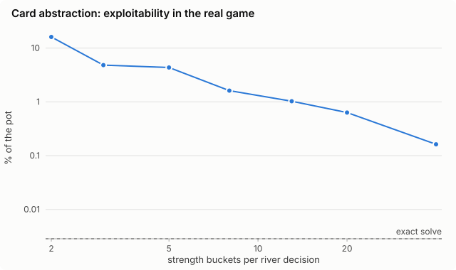

# Sensitivity to abstraction

Spot: NLH SRP river BTN vs BB, Qs8h5d3c2s, 2 sizes.

## Card abstraction

At every river decision the acting player's hands are grouped into *k* equal-weight buckets by hand strength; a bucket shares one strategy. The abstract game is solved, and the resulting strategy is then measured **in the real game** (every hand separately) by an exact best response.

| Buckets | Exploitability (% pot) | Value out of position | Solver memory |
|---|---:|---:|---:|
| 2 | 16.104 | 1.146 | 1 kB |
| 3 | 4.826 | 1.328 | 1 kB |
| 5 | 4.355 | 1.341 | 2 kB |
| 8 | 1.618 | 1.287 | 3 kB |
| 13 | 1.028 | 1.322 | 5 kB |
| 20 | 0.633 | 1.364 | 8 kB |
| 40 | 0.163 | 1.378 | 17 kB |
| exact (no buckets) | 0.003 | 1.388 | 87 kB |

Coarse buckets are badly exploitable (a strategy that cannot tell top pair from a bluff-catcher cannot balance either); the error falls steadily with finer buckets, but even 40 buckets stay above the exact solve.

## Action abstraction

The same spot with different bet menus. Each is solved to near equilibrium in its own tree.

| Menu | Value OOP | Value IP | Exploitability (% pot) | Decision nodes | Root strategy |
|---|---:|---:|---:|---:|---:|
| one size (75%) | 1.387 | 4.613 | 0.024 | 6 | Check 100% · Bet 75% 0% |
| two sizes (33%, 75%) | 1.387 | 4.613 | 0.040 | 10 | Check 100% · Bet 33% 0% · Bet 75% 0% |
| three sizes (33%, 75%, 150%) | 1.384 | 4.616 | 0.025 | 14 | Check 100% · Bet 33% 0% · Bet 75% 0% · Bet 150% 0% |
| five sizes + all-in | 1.424 | 4.576 | 0.042 | 44 | Check 100% · Bet 25% 0% · Bet 50% 0% · Bet 75% 0% · Bet 100% 0% · Bet 150% 0% · All-in 0% |

Richer menus change the players' values by a few hundredths of a big blind on this spot: the bet menu is a mild abstraction here, but one this experiment cannot bound in general (an opponent using an off-menu size is outside every tree above).

## A classic pathology in Leduc

Merging jacks and queens into one card class (both preflop and as the public card) and solving the merged game gives a strategy that loses 0.750 chips per hand to a best response in the real game, against 4.2e-05 for the same algorithm on the full game (132 instead of 288 information sets).
