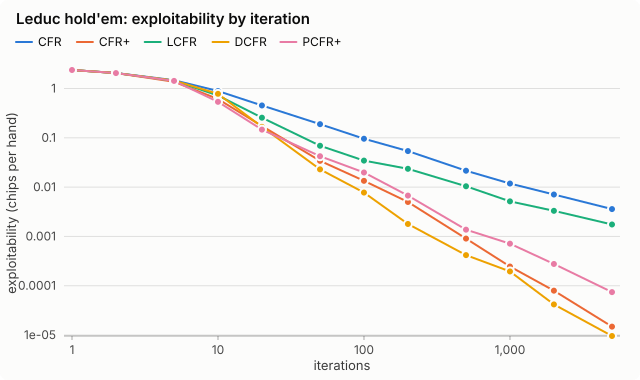
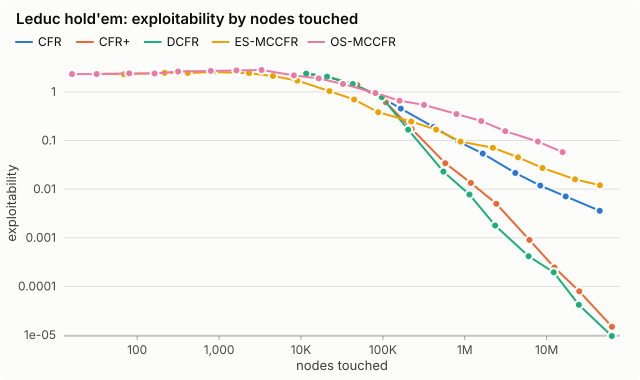

# The CFR family on Kuhn and Leduc poker

Five full-width variants (alternating updates) and two Monte Carlo variants, on the two-player games where exploitability can be computed exactly. Exploitability is NashConv/2 in chips per hand.

| Algorithm | 10 it. | 100 it. | 1,000 it. | 5,000 it. | CPU s (5,000 it.) |
|---|---:|---:|---:|---:|---:|
| CFR | 8.89e-01 | 9.57e-02 | 1.18e-02 | 3.59e-03 | 0.53 |
| CFR+ | 6.10e-01 | 1.34e-02 | 2.45e-04 | 1.48e-05 | 0.69 |
| LCFR | 7.21e-01 | 3.45e-02 | 5.14e-03 | 1.75e-03 | 0.62 |
| DCFR | 7.79e-01 | 7.75e-03 | 1.95e-04 | 9.56e-06 | 1.03 |
| PCFR+ | 5.37e-01 | 1.98e-02 | 7.13e-04 | 7.42e-05 | 1.00 |

| Monte Carlo variant | Iterations | Nodes touched | Final exploitability |
|---|---:|---:|---:|
| ES-MCCFR | 1,000,000 | 44,750,453 | 1.20e-02 |
| OS-MCCFR (ε = 0.6) | 1,000,000 | 15,655,681 | 5.76e-02 |

## Reading the results

* Vanilla CFR converges slowly, roughly like 1/√T: 1.2e-02 chips per hand after 1,000 iterations on Leduc and 3.6e-03 after 5,000. It matches an independent reference implementation to 1e-12, so this is the algorithm, not a bug.
* Floored regrets (CFR+), discounting (DCFR) and prediction (PCFR+) are one to two and a half orders of magnitude better at equal iterations: DCFR reaches 1.9e-04 at 1,000 iterations and 9.6e-06 at 5,000. DCFR with (α, β, γ) = (1.5, 0, 2) is the default everywhere in this repository.
* Per node touched, sampling variants spend far less per iteration but converge noisily; on a game as small as Leduc full-width DCFR wins. Sampling matters for games too large to traverse, which is why the multiway blueprint literature uses it.

Measured on CPU seconds on a shared laptop (AMD Ryzen AI 7 PRO 350, 8 cores / 16 threads) running other jobs; compare iterations and nodes touched for convergence; 4 threads.
