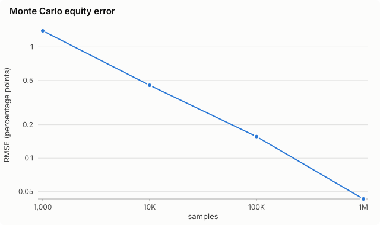

# Equity: exactness, Monte Carlo error and running it twice

## Exact enumeration

| Case | Runouts | Equity | CPU s |
|---|---:|---:|---:|
| NLH preflop AsAh vs KsKh | 1,712,304 | 82.637% / 17.363% | 0.12 |
| NLH preflop AhKh vs QsQd | 1,712,304 | 46.214% / 53.786% | 0.25 |
| NLH flop 3-way | 903 | 51.384% / 29.790% / 18.826% | 0.00 |
| PLO flop | 820 | 50.732% / 49.268% | 0.00 |
| PLO preflop | 1,086,008 | 61.481% / 38.519% | 1.56 |
| Short deck preflop AKs vs JJ | 201,376 | 50.582% / 49.418% | 0.00 |
| Double board flop | 671,580 | 40.418% / 59.582% | 0.09 |
| Omaha hi-lo flop | 820 | 79.146% / 20.854% | 0.00 |

## Monte Carlo against the exact answer

NLH preflop AhKh vs QsQd: exact equity 46.2145%.

| Samples | Runs | Mean abs. error (pp) | RMSE (pp) | 95% interval coverage |
|---|---:|---:|---:|---:|
| 1,000 | 100 | 1.1527 | 1.3983 | 97% |
| 10,000 | 100 | 0.3680 | 0.4524 | 100% |
| 100,000 | 100 | 0.1276 | 0.1565 | 95% |
| 1,000,000 | 20 | 0.0355 | 0.0430 | 100% |

The error falls like 1/√n and the reported 95% intervals cover the exact value at close to the nominal rate, so the standard errors shown in the demo can be trusted.

## Running it twice

Each run is marginally a uniformly random runout, so the expected share is exactly the one-run equity. The variance falls by more than half because the runs are negatively correlated (the second is dealt from what the first left). The figures below are exact: the cross moment over all ordered pairs of disjoint runouts is computed by inclusion-exclusion over runout subsets, 2^k lookups per runout instead of a quadratic loop.

| All-in | Equity | SD of share, once | SD of share, twice | Correlation of the runs | Runouts |
|---|---:|---:|---:|---:|---:|
| preflop AsAh vs KsKh | 82.64% | 37.7% | 25.5% | -0.085 | 1,712,304 |
| flop AhKh vs QsQd on Th7h2c | 54.44% | 49.8% | 34.6% | -0.035 | 990 |
| turn AhKh vs QsQd on Th7h2c3d | 34.09% | 47.4% | 33.1% | -0.023 | 44 |
| flop 8h9h vs AsAd on 7h6c2h (combo draw) | 56.26% | 49.6% | 34.5% | -0.034 | 990 |
