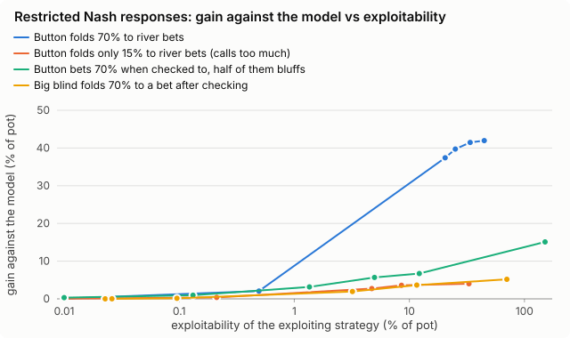

# Equilibrium versus exploitation

Spot: NLH SRP river BTN vs BB, Qs8h5d3c2s, 2 sizes (pot 6 bb). Player 0 is the big blind (out of position), player 1 the button.

## Method

1. Solve the spot to near equilibrium (DCFR, 1000 iterations).
2. Build an **opponent model**: the modelled player's equilibrium strategy with the profile's decisions replaced by threshold play on the range reaching each node (fold the weakest share to a bet, raise the strongest; bet value from the top and bluffs from the bottom).
3. Solve a **restricted Nash response** (Johanson, Zinkevich and Bowling, 2007) for p from 0 to 1: the opponent plays the model with probability p and freely otherwise, unseen by the exploiter. p = 0 is the equilibrium; p = 1 the best response to the model.
4. For each solution report its value against the model and its exploitability: what a best-responding opponent could gain over the equilibrium value.

| Opponent model | p | Value vs model (bb) | Gain (% pot) | Exploitability (% pot) |
|---|---:|---:|---:|---:|
| Button folds 70% to river bets | 0.00 | 1.388 | +0.0 | 0.00 |
| Button folds 70% to river bets | 0.10 | 1.394 | +0.1 | 0.00 |
| Button folds 70% to river bets | 0.25 | 1.512 | +2.1 | 0.49 |
| Button folds 70% to river bets | 0.50 | 3.633 | +37.4 | 20.46 |
| Button folds 70% to river bets | 0.75 | 3.771 | +39.7 | 25.09 |
| Button folds 70% to river bets | 0.90 | 3.877 | +41.5 | 33.75 |
| Button folds 70% to river bets | 1.00 | 3.906 | +42.0 | 44.75 |
| Button folds only 15% to river bets (calls too much) | 0.00 | 1.388 | +0.0 | 0.00 |
| Button folds only 15% to river bets (calls too much) | 0.10 | 1.388 | +0.0 | 0.00 |
| Button folds only 15% to river bets (calls too much) | 0.25 | 1.391 | +0.0 | 0.00 |
| Button folds only 15% to river bets (calls too much) | 0.50 | 1.411 | +0.4 | 0.21 |
| Button folds only 15% to river bets (calls too much) | 0.75 | 1.552 | +2.7 | 4.71 |
| Button folds only 15% to river bets (calls too much) | 0.90 | 1.604 | +3.6 | 8.54 |
| Button folds only 15% to river bets (calls too much) | 1.00 | 1.629 | +4.0 | 32.93 |
| Button bets 70% when checked to, half of them bluffs | 0.00 | 1.405 | +0.0 | 0.00 |
| Button bets 70% when checked to, half of them bluffs | 0.10 | 1.424 | +0.3 | 0.00 |
| Button bets 70% when checked to, half of them bluffs | 0.25 | 1.463 | +1.0 | 0.13 |
| Button bets 70% when checked to, half of them bluffs | 0.50 | 1.595 | +3.2 | 1.35 |
| Button bets 70% when checked to, half of them bluffs | 0.75 | 1.746 | +5.7 | 4.98 |
| Button bets 70% when checked to, half of them bluffs | 0.90 | 1.808 | +6.7 | 12.20 |
| Button bets 70% when checked to, half of them bluffs | 1.00 | 2.311 | +15.1 | 151.07 |
| Big blind folds 70% to a bet after checking | 0.00 | 4.645 | +0.0 | 0.02 |
| Big blind folds 70% to a bet after checking | 0.10 | 4.645 | +0.0 | 0.02 |
| Big blind folds 70% to a bet after checking | 0.25 | 4.646 | +0.0 | 0.03 |
| Big blind folds 70% to a bet after checking | 0.50 | 4.654 | +0.2 | 0.10 |
| Big blind folds 70% to a bet after checking | 0.75 | 4.761 | +1.9 | 3.20 |
| Big blind folds 70% to a bet after checking | 0.90 | 4.864 | +3.7 | 11.60 |
| Big blind folds 70% to a bet after checking | 1.00 | 4.956 | +5.2 | 70.35 |

## Reading the frontier

* Against a button that folds 70% to river bets, the equilibrium gains nothing extra: at equilibrium the big blind checks its whole range on this river, so the button's response to bets never comes up. A restricted Nash response with p = 0.5 starts betting, wins about a third of the pot more against the model, and can itself be exploited for about a fifth of the pot.
* Exploitation is cheap at first and expensive at the end: the last steps to the best response buy little extra value for a large increase in exploitability (up to 151% of the pot for the button that over-bluffs).
* The model is only as good as its frequencies: [opponent-model.md](opponent-model.md) measures how fast those frequencies can be estimated from hands.
