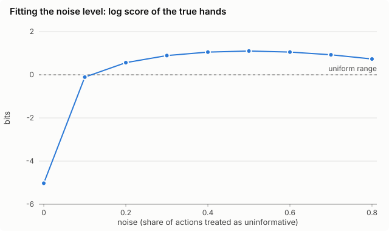
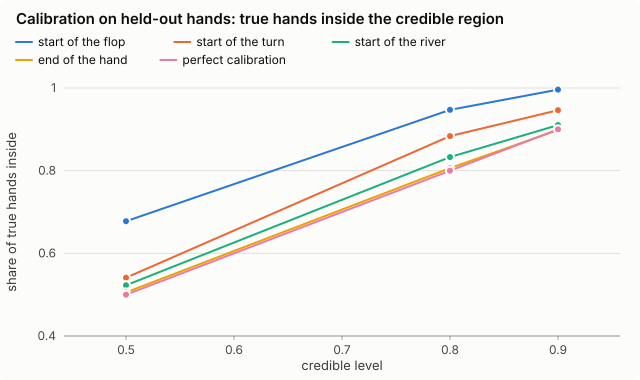

# Street-by-street ranges and the river review

Corpus: the 20,000 simulated hands of [opponent-model.md](opponent-model.md) (24 bots of six styles), regenerated in process from the same seed. The frequency table is built from all 20,000 hands, as a player would build it from a database; the ranges are scored on 1,903 hands that reach the flop, where every player's cards are known.

## The model

Each player starts with the 1,326 combos equally likely. Each action multiplies the combo weights by the probability a model of play gives it: a threshold strategy built from the player's frequencies in that context (strongest hands raise, weakest fold; after the flop value from the top and bluffs from the bottom), mixed with a share *noise* of actions that follow the frequencies regardless of the cards. The method is in [docs/HAND-HISTORIES.md](../../docs/HAND-HISTORIES.md) and [docs/ALGORITHMS.md](../../docs/ALGORITHMS.md).

Two scores per player and snapshot (start of each street, end of the hand):

* **bits**: log2 of the probability of the true combo times the number of combos possible: how much more likely the reconstructed range makes the true hand than a uniform range does (0 = no information, negative = misleading);
* **coverage**: whether the true combo lies inside the 50%, 80% and 90% most likely part of the range. A calibrated model covers at those rates.

## Fitting the noise

The noise level is fitted on the first half of the evaluated hands by the mean log score (a proper scoring rule) and then fixed.

| Noise | Mean bits | Median bits | 50% region | 80% region | 90% region | Range kept (effective share) |
|---|---:|---:|---:|---:|---:|---:|
| 0.0 | -5.03 | +0.50 | 30% | 44% | 50% | 20% |
| 0.1 | -0.11 | +1.05 | 33% | 53% | 62% | 26% |
| 0.2 | +0.56 | +1.10 | 36% | 62% | 74% | 33% |
| 0.3 | +0.89 | +1.15 | 41% | 71% | 84% | 41% |
| 0.4 | +1.05 | +1.14 | 49% | 79% | 90% | 50% |
| 0.5 | +1.10 | +1.07 | 58% | 87% | 94% | 59% |
| 0.6 | +1.05 | +0.96 | 68% | 92% | 96% | 69% |
| 0.7 | +0.93 | +0.79 | 76% | 95% | 98% | 80% |
| 0.8 | +0.73 | +0.59 | 83% | 96% | 99% | 89% |

Without noise the model treats every action as fully revealing: the median hand is still located (positive median), but each slow-play or float rules the true hand nearly out, so the mean log score is strongly negative and the 90% regions cover the truth half the time. The chosen level is **0.5**.

## Held-out results

| Snapshot | Players | Mean bits | 50% region | 80% region | 90% region | Range kept |
|---|---:|---:|---:|---:|---:|---:|
| start of the flop | 2,290 | +0.95 | 68% | 95% | 100% | 72% |
| start of the turn | 2,011 | +1.01 | 54% | 88% | 95% | 61% |
| start of the river | 1,628 | +1.04 | 52% | 83% | 91% | 54% |
| end of the hand | 1,909 | +1.11 | 51% | 81% | 90% | 49% |

| Variant (held-out half) | Mean bits | 90% region |
|---|---:|---:|
| fitted model (player frequencies, noise) | +1.02 | 94% |
| population frequencies only | +0.63 | 89% |
| no noise (pure threshold play) | -4.91 | 51% |

* Player-specific frequencies matter: they reveal 0.39 bits per snapshot more than population frequencies.
* Calibration: overall the 50%, 80% and 90% regions hold the true hand 57%, 87% and 94% of the time, a little conservative; most so at the start of the flop (68%, 95%, 100%), and close to nominal by the end of the hand (51%, 81%, 90%).
* Tight players are easier to read than loose ones at the river:

| Style | River snapshots | Mean bits | 90% region |
|---|---:|---:|---:|
| nit | 118 | +1.59 | 92% |
| tag | 215 | +1.17 | 91% |
| lag | 311 | +1.05 | 92% |
| station | 461 | +1.06 | 93% |
| maniac | 362 | +0.67 | 90% |
| weak-tight | 161 | +1.23 | 86% |

## River review

`pe bench review` reviews the heads-up river decisions in the first 6,000 hands of the corpus: 1,945 rivers, 4,543 decisions. Each river is solved with the reconstructed ranges (on average 1,081 and 1,081 combos: the noise keeps every combo above the pruning threshold) to 0.28% of the pot on average, in 102 iterations.

A decision is **on the equilibrium path** when the equilibrium reaches it with the player's own line at least 5% of the time and with the opponent's range at least 2%. Off the path, the solver explores the decision little (low exploitability says nothing about play that is almost never reached), so its strategy and values there are rough; the tables report costs on the path and, in the last column, over all decisions.

| Style | Decisions | On the path | Mean cost on path (bb) | Median | 90th percentile | Cost above 1 bb | Rarely played at equilibrium | Mean cost, all decisions |
|---|---:|---:|---:|---:|---:|---:|---:|---:|
| lag | 858 | 93% | 0.99 | 0.01 | 2.86 | 22% | 31% | 1.16 |
| maniac | 1,071 | 95% | 1.52 | 0.01 | 4.23 | 25% | 32% | 1.87 |
| nit | 350 | 92% | 1.30 | 0.00 | 2.66 | 21% | 25% | 1.46 |
| station | 1,235 | 93% | 1.09 | 0.00 | 2.01 | 15% | 24% | 1.17 |
| tag | 585 | 92% | 0.74 | 0.00 | 1.99 | 16% | 26% | 0.95 |
| weak-tight | 444 | 93% | 0.82 | 0.00 | 1.34 | 11% | 19% | 0.92 |
| all | 4,543 | 93% | 1.12 | 0.00 | 2.73 | 19% | 27% | 1.30 |

| Action taken | Decisions | On the path | Mean cost on path (bb) | Cost above 1 bb |
|---|---:|---:|---:|---:|
| All-in | 408 | 96% | 1.48 | 27% |
| Bet | 905 | 100% | 1.36 | 32% |
| Call | 1,127 | 79% | 1.55 | 24% |
| Check | 1,905 | 100% | 0.79 | 10% |
| Fold | 154 | 77% | 0.12 | 4% |
| Raise | 44 | 64% | 1.55 | 50% |

The costliest decisions on the path:

| Hand | Player | Cards | Taken | Best | Cost (bb) | Played at eq. |
|---|---:|---:|---:|---:|---:|---:|
| 3415 | Player18 (weak-tight) | 9d9c | Check | All-in | 60.34 | 0% |
| 3956 | Player10 (station) | Ad3d | Bet 100% | Check | 37.23 | 0% |
| 3694 | Player23 (maniac) | QhJs | All-in | Check | 34.60 | 0% |
| 7 | Player17 (maniac) | Ts5d | Call | Fold | 34.30 | 0% |
| 2687 | Player05 (maniac) | Kd3d | Call | Fold | 33.35 | 0% |
| 3064 | Player22 (station) | 6h6d | Check | All-in | 31.90 | 0% |
| 5716 | Player04 (station) | 7s7c | Check | All-in | 31.87 | 0% |
| 5922 | Player07 (nit) | AsAc | Call | All-in | 31.15 | 0% |

Off the path the costs can look larger and contradict the frequencies, for example hand 5915, Ah6d call (52 bb; the opponent's line has an equilibrium probability of 1.40%; the solver's frequency for the action there is 0%); hand 3694, QdQc call (44 bb; the opponent's line has an equilibrium probability of 0.06%; the solver's frequency for the action there is 92%); hand 649, Kh9c call (43 bb; the player's own line has an equilibrium probability of 0.00%; the solver's frequency for the action there is 43%). These are the cases the path flag is for.

Reading the numbers: a cost is the value of the best action minus the value of the action taken, both with equilibrium play afterwards, against the reconstructed ranges. "Rarely played": on-path decisions the equilibrium takes less than 5% of the time with that hand. The costs are heavy-tailed: most decisions cost nothing or little, and a few cost tens of big blinds. The ranges are estimates and the opponent is assumed balanced, so these are costs in a model; they rank decisions for study, they are not the bots' true losses.

## Limits

The bots are a parametric model of player types; real players adapt and mix in ways a fitted noise level may not capture, so read these scores as a best case for this model. Ranges are hold'em only and taken from an observer's point of view.
