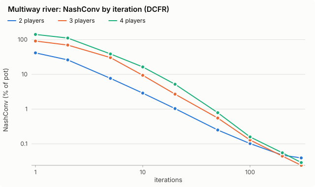

# Performance and guarantees as the player count grows

## What changes with three or more players

With two players (zero-sum), CFR's average strategy converges to a Nash equilibrium and exploitability is the natural error measure. With three or more:

* no theorem says CFR converges to a Nash equilibrium, and in general it does not;
* equilibria need not be unique or interchangeable, so "the" equilibrium strategy of one player is not well defined;
* the right error measure is **NashConv**: the total that all players could gain by switching to best responses. It is computed exactly here, and small values certify an approximate equilibrium **of this abstracted game only**.

Every multiway result in this repository is labelled "multiway CFR approximation: no Nash guarantee".

## Multiway rivers (exact card removal by joint enumeration)

About 17 combos per player on Ks 7d 2c 9h 4s, one bet size (75%) and one raise.

| Players | Hands per player | Joint hand combinations | CPU / iteration | NashConv at start (% pot) | NashConv after 300 it. | Memory |
|---|---:|---:|---:|---:|---:|---:|
| 2 | 18 / 18 | 280 | 0.00 ms | 41.6 | 0.039 | 3 kB |
| 3 | 18 / 18 / 16 | 3,490 | 0.62 ms | 91.2 | 0.024 | 28 kB |
| 4 | 18 / 18 / 16 / 17 | 38,885 | 46.09 ms | 141.2 | 0.029 | 329 kB |

The joint enumeration is exact (every player's cards, folded players included, block the others) but costs the product of the range sizes, about twelve times more per added player here. That is the practical limit of exact multiway solving; larger spots need sampling and card abstraction, whose error can then only be measured on small instances like these.

## Kuhn and Leduc for 2 to 5 players

| Game | Method | Information sets | Tree nodes | Iterations | NashConv | CPU / iteration | Memory |
|---|---:|---:|---:|---:|---:|---:|---:|
| kuhn-2p | CFR | 12 | 55 | 2,000 | 1.08e-03 | 0.000 ms | 0.0 MB |
| kuhn-2p | DCFR | 12 | 55 | 2,000 | 1.84e-04 | 0.000 ms | 0.0 MB |
| kuhn-2p | ES-MCCFR | 12 | 55 | 40,000 | 1.50e-03 | 0.000 ms | 0.0 MB |
| kuhn-3p | CFR | 48 | 601 | 2,000 | 1.94e-03 | 0.008 ms | 0.0 MB |
| kuhn-3p | DCFR | 48 | 601 | 2,000 | 2.62e-06 | 0.008 ms | 0.0 MB |
| kuhn-3p | ES-MCCFR | 48 | 601 | 40,000 | 1.61e-02 | 0.000 ms | 0.0 MB |
| kuhn-4p | CFR | 160 | 7,801 | 2,000 | 3.33e-03 | 0.156 ms | 0.3 MB |
| kuhn-4p | DCFR | 160 | 7,801 | 2,000 | 2.47e-06 | 0.117 ms | 0.3 MB |
| kuhn-4p | ES-MCCFR | 160 | 7,801 | 40,000 | 2.24e-02 | 0.002 ms | 0.3 MB |
| kuhn-5p | CFR | 480 | 115,921 | 300 | 2.52e-02 | 2.031 ms | 5.2 MB |
| kuhn-5p | DCFR | 480 | 115,921 | 300 | 2.63e-04 | 2.188 ms | 5.2 MB |
| kuhn-5p | ES-MCCFR | 480 | 115,921 | 6,000 | 1.65e-01 | 0.008 ms | 5.2 MB |
| leduc-2p | DCFR | 288 | 9,457 | 2,000 | 8.36e-05 | 0.148 ms | 0.4 MB |
| leduc-2p | CFR | 288 | 9,457 | 2,000 | 1.42e-02 | 0.117 ms | 0.4 MB |
| leduc-3p | DCFR | 7,428 | 1,831,601 | 200 | 2.03e-02 | 58.906 ms | 71.1 MB |
| leduc-3p | CFR | 7,428 | 1,831,601 | 200 | 2.48e-01 | 47.656 ms | 71.1 MB |

Tree size grows exponentially with the number of players (Kuhn: 55 nodes for two players, 115,921 for five; Leduc: 9,457 for two, 1,831,601 for three). In these small games CFR's NashConv does fall close to zero empirically, which is consistent with published results on three-player Kuhn, but it is an observation, not a guarantee.

Measured on CPU seconds on a shared laptop (AMD Ryzen AI 7 PRO 350, 8 cores / 16 threads) running other jobs; compare iterations and nodes touched for convergence; 4 threads.
