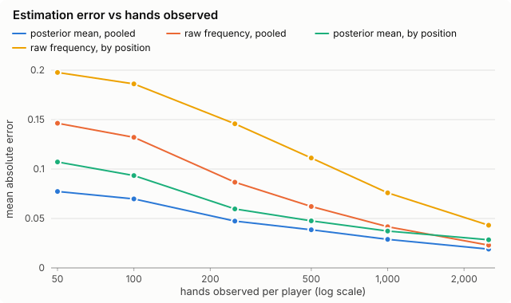
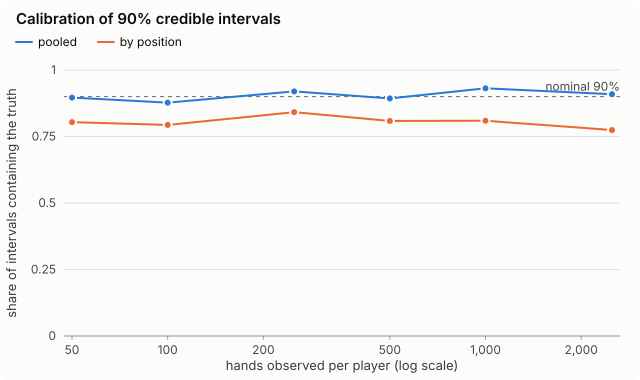
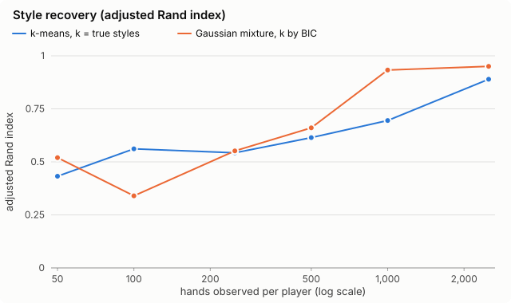
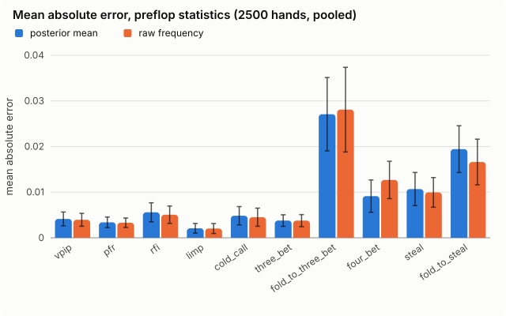
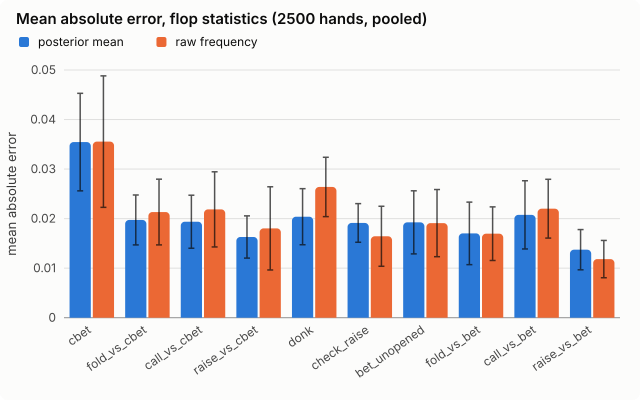
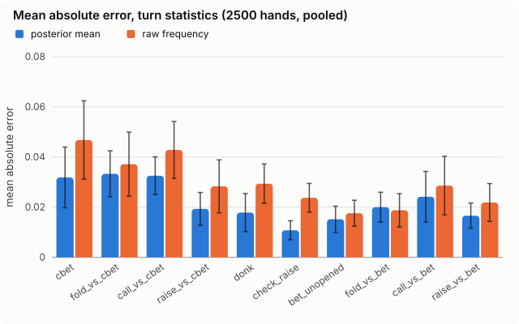
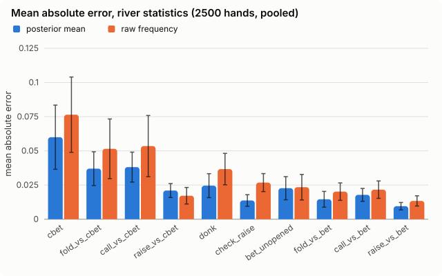
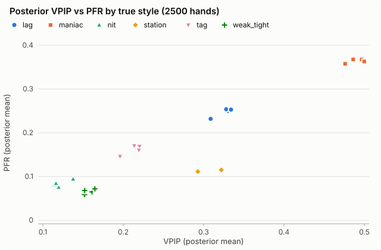
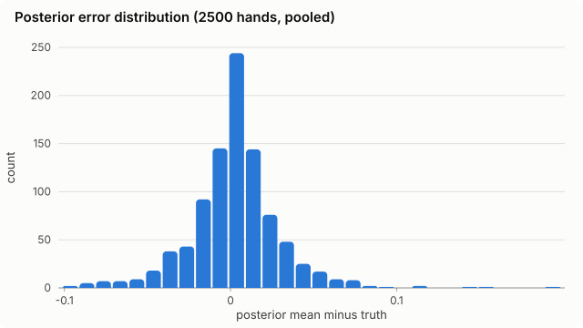

# Opponent model evaluation

> **This evaluation uses a synthetic corpus.** Every hand was generated by simulated bots with
> known styles; the true frequencies come from the bots' own action probabilities. What that implies:
>
> * The bots follow fixed, stationary policies: they do not adapt, tilt or change stakes. Errors on real opponents will be larger and the population is not a fixed set of archetypes.
> * Ground truth (the bots' own action probabilities) exists only in simulation. On real hand histories the model can only be checked indirectly, e.g. by predicting held-out hands.
> * Styles are discrete archetypes with modest per-bot jitter, which makes clustering easier than in real player pools where styles form a continuum.
> * Population priors are fitted on the same players that are evaluated (no held-out players).
> * Each true value is an average of the bot's decision probabilities over a finite number of spots, so it carries a little noise of its own.

## Corpus

* hands: 20000 (20000 synthetic)
* players: 24 (24 with a style in players.json)
* styles: lag (4), maniac (4), nit (4), station (4), tag (4), weak_tight (4)
* hands per player: min 4880, median 5000.5, max 5163
* statistics evaluated: 41 (truth-evaluable ones; at least 20 truth-carrying opportunities per player and statistic)

## Method

Hierarchical empirical-Bayes Beta-binomial model (`poker_ecosystem.opponent`): population priors per
statistic and per position fitted by maximum marginal likelihood with a weak boundary-avoiding prior,
player-position priors shifted by the player's leave-one-position-out logit deviation (whose
uncertainty widens the prior), conjugate posteriors with equal-tailed
90% credible intervals. For each sample size N, every player with at least N hands is
represented by a seeded random subsample of N hands (nested across sizes); the model is refitted on
those subsamples and compared with each bot's true frequency over the full corpus.

Approximations in the model:

* Empirical Bayes: population priors are point estimates (maximum marginal likelihood plus a weak boundary-avoiding Gamma(2) prior on the between-player SD); their uncertainty is not propagated, so intervals are slightly too narrow when few players inform a prior.
* Each population prior is a single Beta distribution. A pool made of distinct styles is multimodal, so players far from the pool mean are over-shrunk until their own sample dominates.
* The player-position prior is centred on a plug-in estimate of the player's overall logit deviation (leave-one-position-out, shrunk); its uncertainty enters the prior variance only to first order (delta method).
* Opportunities are treated as exchangeable Bernoulli trials given the player's frequency; real spots differ (stacks, opponents, multiway) and af_* counts several correlated decisions per hand.
* Preflop ranges assume the player plays the top x% of hands by a fixed ranking (Chen formula unless research/vectors/preflop_ranking.json exists); mixed and polarised ranges are not modelled.
* River bluff share and the value threshold are learned only from bets that reached showdown with derived.river_strength; they describe called bets, not every bet.

## Results

| hands | players | pairs | MAE posterior | MAE raw (same pairs) | shrinkage gain | RMSE posterior | coverage (90%) | interval width | ARI k-means | ARI GMM (k) |
|---|---|---|---|---|---|---|---|---|---|---|
| 50 | 24 | 945 | 0.077 | 0.146 (0.076) | 0.070 | 0.112 | 0.896 | 0.351 | 0.432 | 0.520 (8) |
| 100 | 24 | 945 | 0.070 | 0.132 (0.070) | 0.062 | 0.106 | 0.877 | 0.293 | 0.561 | 0.340 (3) |
| 250 | 24 | 945 | 0.047 | 0.087 (0.047) | 0.040 | 0.072 | 0.920 | 0.207 | 0.543 | 0.552 (4) |
| 500 | 24 | 945 | 0.039 | 0.062 (0.039) | 0.024 | 0.056 | 0.893 | 0.161 | 0.614 | 0.661 (7) |
| 1000 | 24 | 945 | 0.029 | 0.042 (0.029) | 0.013 | 0.043 | 0.931 | 0.130 | 0.695 | 0.933 (7) |
| 2500 | 24 | 945 | 0.019 | 0.023 (0.019) | 0.004 | 0.028 | 0.909 | 0.090 | 0.889 | 0.950 (7) |

Pooled = one estimate per player and statistic over all positions. "MAE raw (same pairs)" compares the raw
frequency k/n with the posterior mean on the pairs with at least one observation; the shrinkage gain is
their difference (positive = the model beats raw frequencies).

Position-level estimates (one per player, statistic and position):

| hands | pairs | MAE posterior | MAE raw (same pairs) | shrinkage gain | coverage |
|---|---|---|---|---|---|
| 50 | 3791 | 0.107 | 0.198 (0.108) | 0.090 | 0.804 |
| 100 | 3791 | 0.093 | 0.186 (0.093) | 0.093 | 0.793 |
| 250 | 3791 | 0.060 | 0.146 (0.057) | 0.089 | 0.841 |
| 500 | 3791 | 0.048 | 0.111 (0.047) | 0.064 | 0.808 |
| 1000 | 3791 | 0.037 | 0.076 (0.037) | 0.039 | 0.809 |
| 2500 | 3791 | 0.028 | 0.043 (0.028) | 0.015 | 0.774 |

## Figures

*Mean absolute error against hands observed.*

*Share of credible intervals containing the true frequency.*

*Recovery of the true styles by clustering.*

*Error per preflop statistic at the largest sample size (95% error bars).*

*Error per flop statistic at the largest sample size (95% error bars).*

*Error per turn statistic at the largest sample size (95% error bars).*

*Error per river statistic at the largest sample size (95% error bars).*

*Posterior VPIP and PFR by true style (colour and marker shape).*

*Distribution of posterior errors at the largest sample size.*

## Per statistic (2500 hands, pooled)

| statistic | pairs | mean n | MAE posterior | MAE raw | coverage |
|---|---|---|---|---|---|
| `vpip` | 24 | 2388.5 | 0.004 | 0.004 | 1.000 |
| `pfr` | 24 | 2388.5 | 0.003 | 0.003 | 1.000 |
| `rfi` | 24 | 1231.8 | 0.006 | 0.005 | 1.000 |
| `limp` | 24 | 1299.4 | 0.002 | 0.002 | 0.500 |
| `cold_call` | 24 | 974.7 | 0.005 | 0.005 | 1.000 |
| `three_bet` | 24 | 996.0 | 0.004 | 0.004 | 0.917 |
| `fold_to_three_bet` | 24 | 72.0 | 0.027 | 0.028 | 1.000 |
| `four_bet` | 24 | 185.4 | 0.009 | 0.013 | 0.958 |
| `steal` | 24 | 501.0 | 0.011 | 0.010 | 0.958 |
| `fold_to_steal` | 24 | 250.2 | 0.019 | 0.017 | 0.958 |
| `cbet_flop` | 24 | 154.8 | 0.035 | 0.036 | 0.875 |
| `fold_vs_cbet_flop` | 24 | 117.6 | 0.020 | 0.021 | 0.875 |
| `call_vs_cbet_flop` | 24 | 117.6 | 0.019 | 0.022 | 1.000 |
| `raise_vs_cbet_flop` | 24 | 117.6 | 0.016 | 0.018 | 1.000 |
| `donk_flop` | 24 | 131.2 | 0.020 | 0.026 | 1.000 |
| `check_raise_flop` | 24 | 95.6 | 0.019 | 0.016 | 0.750 |
| `bet_unopened_flop` | 24 | 360.9 | 0.019 | 0.019 | 0.958 |
| `fold_vs_bet_flop` | 24 | 211.0 | 0.017 | 0.017 | 1.000 |
| `call_vs_bet_flop` | 24 | 211.0 | 0.021 | 0.022 | 1.000 |
| `raise_vs_bet_flop` | 24 | 211.0 | 0.014 | 0.012 | 0.917 |
| `cbet_turn` | 24 | 82.3 | 0.032 | 0.047 | 0.958 |
| `fold_vs_cbet_turn` | 24 | 56.8 | 0.033 | 0.037 | 0.875 |
| `call_vs_cbet_turn` | 24 | 56.8 | 0.033 | 0.043 | 0.958 |
| `raise_vs_cbet_turn` | 24 | 56.8 | 0.019 | 0.028 | 0.750 |
| `donk_turn` | 24 | 81.0 | 0.018 | 0.029 | 0.917 |
| `check_raise_turn` | 24 | 62.8 | 0.011 | 0.024 | 0.958 |
| `bet_unopened_turn` | 24 | 325.1 | 0.015 | 0.018 | 1.000 |
| `fold_vs_bet_turn` | 24 | 164.0 | 0.020 | 0.019 | 0.917 |
| `call_vs_bet_turn` | 24 | 164.0 | 0.024 | 0.029 | 0.833 |
| `raise_vs_bet_turn` | 24 | 164.0 | 0.017 | 0.022 | 0.875 |
| `cbet_river` | 21 | 38.7 | 0.060 | 0.076 | 0.857 |
| `fold_vs_cbet_river` | 20 | 27.6 | 0.037 | 0.051 | 0.950 |
| `call_vs_cbet_river` | 20 | 27.6 | 0.038 | 0.054 | 0.950 |
| `raise_vs_cbet_river` | 20 | 27.6 | 0.021 | 0.017 | 0.550 |
| `donk_river` | 24 | 54.5 | 0.025 | 0.037 | 0.833 |
| `check_raise_river` | 24 | 34.9 | 0.014 | 0.027 | 0.833 |
| `bet_unopened_river` | 24 | 269.3 | 0.023 | 0.023 | 0.833 |
| `fold_vs_bet_river` | 24 | 120.6 | 0.015 | 0.020 | 0.958 |
| `call_vs_bet_river` | 24 | 120.6 | 0.018 | 0.022 | 0.958 |
| `raise_vs_bet_river` | 24 | 120.6 | 0.010 | 0.013 | 0.875 |

## Clusters at 2500 hands (Gaussian mixture, k by BIC)

| cluster | heuristic name | size | true styles | VPIP | PFR | 3-bet | flop c-bet |
|---|---|---|---|---|---|---|---|
| 0 | loose-passive | 4 | station 4 | 0.307 | 0.113 | 0.023 | 0.542 |
| 1 | maniac | 4 | maniac 4 | 0.490 | 0.364 | 0.193 | 0.699 |
| 2 | nit #1 | 4 | weak_tight 4 | 0.157 | 0.066 | 0.021 | 0.568 |
| 3 | nit #2 | 1 | nit 1 | 0.116 | 0.084 | 0.031 | 0.510 |
| 4 | LAG | 4 | lag 4 | 0.325 | 0.247 | 0.117 | 0.645 |
| 5 | nit #3 | 3 | nit 3 | 0.124 | 0.083 | 0.029 | 0.673 |
| 6 | TAG | 4 | tag 4 | 0.212 | 0.161 | 0.064 | 0.623 |

## Limitations

* Only statistics whose success is an action choice are evaluated; WTSD, W$SD, aggression frequency,
  sizing and the river bluff share have no per-decision truth.
* Interval coverage below the nominal level points at over-shrinkage: a single Beta prior cannot follow
  a pool of distinct styles (multimodal), and the Beta-binomial ignores the spot mix within a statistic.
  A synthetic pool of a few sharply separated archetypes is close to the worst case for this.
* Cluster names are heuristic labels from VPIP/PFR thresholds for 6-max cash games.
