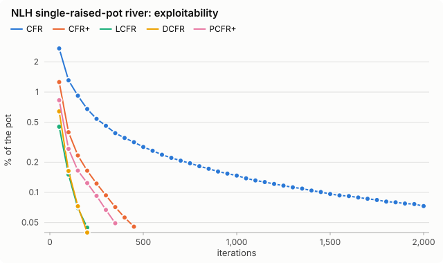

# Range-vs-range solving: runtime, memory and convergence

Heads-up river spots in No-Limit Hold'em, Pot-Limit Omaha and Short Deck, solved by vector-form CFR with exact card removal. Exploitability is measured exactly (a vector best response in the same tree) every 50 iterations and reported as NashConv/2 in % of the starting pot. A solve stops at 0.05% of the pot or 2,000 iterations.

| Spot | Algorithm | Hands | Decision nodes | Iter. to 0.5% | Iter. to 0.1% | Final % pot | CPU s | MB |
|---|---:|---:|---:|---:|---:|---:|---:|---:|
| NLH SRP river BTN vs BB, Qs8h5d3c2s, 2 sizes | CFR | 323 / 93 | 10 | 300 | 1500 | 0.073 | 0.4 | 0.1 |
| NLH SRP river BTN vs BB, Qs8h5d3c2s, 2 sizes | CFR+ | 323 / 93 | 10 | 100 | 300 | 0.046 | 0.1 | 0.1 |
| NLH SRP river BTN vs BB, Qs8h5d3c2s, 2 sizes | LCFR | 323 / 93 | 10 | 50 | 150 | 0.045 | 0.0 | 0.1 |
| NLH SRP river BTN vs BB, Qs8h5d3c2s, 2 sizes | DCFR | 323 / 93 | 10 | 100 | 150 | 0.040 | 0.1 | 0.1 |
| NLH SRP river BTN vs BB, Qs8h5d3c2s, 2 sizes | PCFR+ | 323 / 93 | 10 | 100 | 250 | 0.049 | 0.1 | 0.1 |
| NLH SRP river, 3 sizes + all-in | CFR | 323 / 93 | 32 | 1250 | >2,000 | 0.308 | 1.6 | 0.3 |
| NLH SRP river, 3 sizes + all-in | CFR+ | 323 / 93 | 32 | 300 | 800 | 0.047 | 0.8 | 0.3 |
| NLH SRP river, 3 sizes + all-in | LCFR | 323 / 93 | 32 | 150 | 450 | 0.048 | 0.7 | 0.3 |
| NLH SRP river, 3 sizes + all-in | DCFR | 323 / 93 | 32 | 200 | 450 | 0.049 | 0.6 | 0.3 |
| NLH SRP river, 3 sizes + all-in | PCFR+ | 323 / 93 | 32 | 300 | 800 | 0.049 | 0.9 | 0.5 |
| NLH 3-bet pot river, Ah9d4c4s2h | CFR | 45 / 63 | 10 | 350 | 1750 | 0.092 | 0.1 | 0.0 |
| NLH 3-bet pot river, Ah9d4c4s2h | CFR+ | 45 / 63 | 10 | 100 | 200 | 0.050 | 0.0 | 0.0 |
| NLH 3-bet pot river, Ah9d4c4s2h | LCFR | 45 / 63 | 10 | 100 | 300 | 0.046 | 0.0 | 0.0 |
| NLH 3-bet pot river, Ah9d4c4s2h | DCFR | 45 / 63 | 10 | 50 | 150 | 0.046 | 0.0 | 0.0 |
| NLH 3-bet pot river, Ah9d4c4s2h | PCFR+ | 45 / 63 | 10 | 100 | 250 | 0.050 | 0.0 | 0.0 |
| PLO river, 4-card ranges | CFR | 32,352 / 41,844 | 10 | 300 | 1600 | 0.079 | 439.0 | 15.4 |
| PLO river, 4-card ranges | CFR+ | 32,352 / 41,844 | 10 | 100 | 250 | 0.050 | 82.0 | 15.4 |
| PLO river, 4-card ranges | LCFR | 32,352 / 41,844 | 10 | 100 | 250 | 0.041 | 58.3 | 15.4 |
| PLO river, 4-card ranges | DCFR | 32,352 / 41,844 | 10 | 50 | 150 | 0.031 | 34.9 | 15.4 |
| PLO river, 4-card ranges | PCFR+ | 32,352 / 41,844 | 10 | 100 | 250 | 0.046 | 71.2 | 23.1 |
| Short deck river (Triton rules) | CFR | 465 / 97 | 10 | 450 | >2,000 | 0.104 | 0.3 | 0.1 |
| Short deck river (Triton rules) | CFR+ | 465 / 97 | 10 | 150 | 300 | 0.044 | 0.1 | 0.1 |
| Short deck river (Triton rules) | LCFR | 465 / 97 | 10 | 100 | 250 | 0.042 | 0.1 | 0.1 |
| Short deck river (Triton rules) | DCFR | 465 / 97 | 10 | 100 | 150 | 0.048 | 0.0 | 0.1 |
| Short deck river (Triton rules) | PCFR+ | 465 / 97 | 10 | 150 | 350 | 0.041 | 0.1 | 0.2 |

## A turn spot

The turn solve enumerates all 44 rivers below each betting line (exact chance, no card abstraction).

| Algorithm | Hands | Tree nodes | Iterations | Final % pot | CPU s | MB |
|---|---:|---:|---:|---:|---:|---:|
| DCFR | 69 / 76 | 9,387 | 280 | 0.093 | 14.0 | 10.4 |
| CFR+ | 69 / 76 | 9,387 | 400 | 0.191 | 21.0 | 10.4 |

## What is and is not solved

* "Solved" means an ε-equilibrium of the game defined by the ranges, the board and the **bet menu**. Real no-limit poker allows any size; the menu is an action abstraction (its cost is measured in [abstraction.md](abstraction.md)).
* Card removal is exact: blockers between the two ranges are counted by inclusion-exclusion over each hand's card subsets (3 terms for hold'em, 15 for Omaha).
* Memory is the solver's own state (regrets and strategy sums in f64); the PLO spot holds 32,352 and 41,844 four-card hands.

Measured on CPU seconds on a shared laptop (AMD Ryzen AI 7 PRO 350, 8 cores / 16 threads) running other jobs; compare iterations and nodes touched for convergence; 4 threads.
